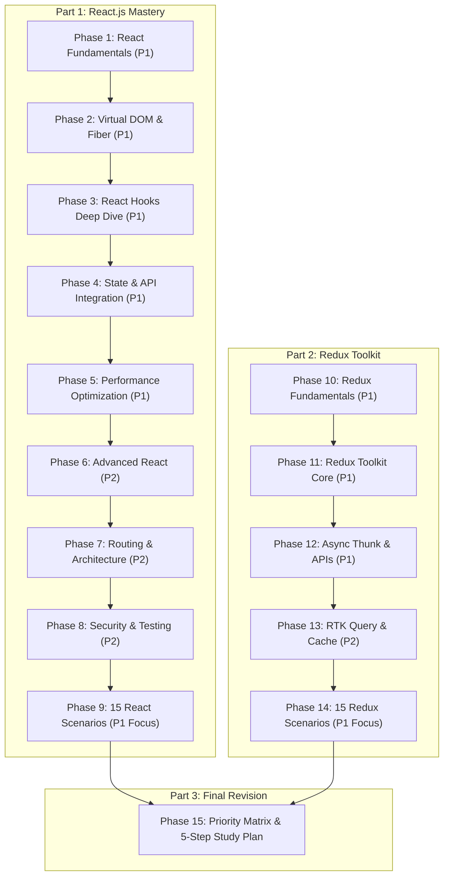
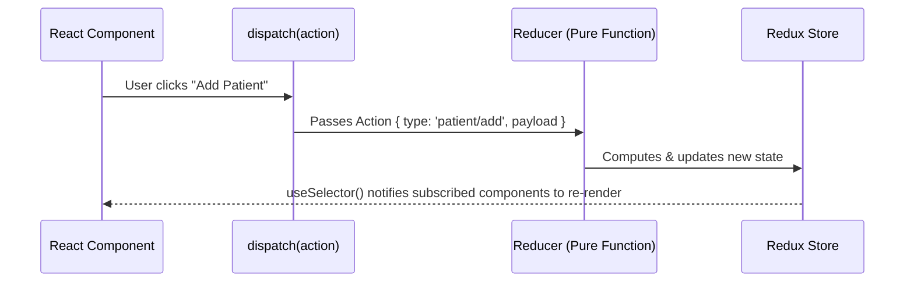

# ⚛️ React.js & Redux Toolkit Phased Master Revision Guide
> **Complete 15-Phase Interview Blueprint (4–5 Years Experience Level)**  
> *Aligned with the Interactive Deck: `react_slide_revision_deck.html` (169 Slides)*

---

## 📑 Roadmap Overview & Study Phasing



---

# Part 1 — React.js Mastery

## Phase 1: React Fundamentals (P1 · Must Prepare)
*Mapped to Slides 1–4, 9–16, 21–27, 27A, 27B*

### 1. What is React.js? Features and Role
- **Definition:** React is an open-source, component-based declarative JavaScript library for building interactive user interfaces for Single Page Applications (SPAs).
- **Core Pillars:**
  1. **Component-Based:** UI is split into reusable, independent atomic blocks.
  2. **Virtual DOM:** Fast reconciliation before touching the browser DOM.
  3. **Declarative Syntax:** You describe *what* the UI should look like based on state; React handles the DOM mutations.
  4. **Unidirectional Data Flow:** Data strictly flows top-down from parent to child via `props`.

### 2. Props vs State Comparison Matrix
| Feature | Props (`properties`) | State |
| :--- | :--- | :--- |
| **Origin** | Passed down by parent component | Initialized & managed internally inside component |
| **Mutability** | **Immutable** (Read-only for receiving component) | **Mutable** via setter function (`useState`) |
| **Re-render** | Yes, re-renders when parent passes new props | Yes, calling state setter triggers re-render |
| **Scope** | External interface / Component contract | Internal memory / Private component data |

### 3. Component Composition & State Lifting
- **State Lifting:** When two sibling components need to synchronize data, lift the state up to their closest common parent.
- **Children Prop:** Enables composition without deep prop drilling.
```jsx
function Card({ title, children }) {
  return (
    <div className="card">
      <h3>{title}</h3>
      {children}
    </div>
  );
}
```

---

## Phase 2: Virtual DOM, Fiber & Rendering (P1 · High Priority)
*Mapped to Slides 6–8, 8A–8C, 19–20*

### 1. Real DOM vs Virtual DOM
- **Real DOM:** Tree representation of HTML elements. Manipulating Real DOM directly is slow because every change triggers costly browser **Reflow** (layout recalculation) and **Repaint**.
- **Virtual DOM (VDOM):** Lightweight JavaScript object representation of the Real DOM in memory.
- **Diffing Algorithm:** $O(n)$ heuristic comparison:
  1. Two elements of different types produce different trees.
  2. Lists use `key` props to identify which items were added, removed, or moved.

### 2. React Fiber & Trigger-Render-Commit Lifecycle
1. **Trigger Phase:** Initial mount or `setState()` schedules a render work unit.
2. **Render Phase (Reconciliation):**
   - React walks the Fiber tree and calls component functions.
   - Computes differences.
   - **Asynchronous & Interruptible:** High-priority user events (clicks, typing) can pause lower-priority background renders.
3. **Commit Phase:**
   - React applies the computed DOM mutations to the actual browser DOM.
   - **Synchronous & Un-interruptible:** Prevents half-updated, flickering screens.

### 3. Double Buffering & Automatic Batching
- **Current Tree vs Work-in-Progress (WIP) Tree:** The screen displays `current`. React builds `workInProgress` in background memory. On commit, a single pointer swap (`root.current = workInProgress`) makes the new tree live.
- **Automatic Batching (React 18):** State updates inside `setTimeout`, promises, and native event listeners are automatically batched into a single re-render.

---

## Phase 3: React Hooks (P1 · Very Important)
*Mapped to Slides 65–76, 76A–76C*

### 1. Rules of Hooks
1. **Only Call at Top Level:** Never call hooks inside loops, conditional statements, or nested functions.
2. **Only Call from React Functions:** Only call hooks inside React functional components or custom hooks.

### 2. useState & Functional Updates
```jsx
// Stale closure bug:
setCount(count + 1); // If called 3 times, count increases by only 1!

// Safe functional update:
setCount(prev => prev + 1); // Guarantees latest queued state!
```

### 3. useEffect & Dependency Array Scenarios
- `useEffect(fn)`: Runs after **every** render.
- `useEffect(fn, [])`: Runs **only once** on mount; cleanup runs on unmount.
- `useEffect(fn, [propA, stateB])`: Runs on mount and whenever `propA` or `stateB` change by referential equality (`Object.is`).

### 4. Hook Comparison Matrix
| Hook | What It Caches / Returns | Triggers Re-render? | Typical Use Case |
| :--- | :--- | :--- | :--- |
| `useState` | State value + setter function | **Yes** (when setter called) | Data that directly controls UI rendering |
| `useRef` | Mutable object `{ current: val }` | **No** | DOM nodes, timer IDs, previous state storage |
| `useMemo` | Cached return value of a function | **No** | Expensive computations ($O(N^2)$), memoized objects |
| `useCallback`| Cached function definition | **No** | Stable callback references passed to memoized children |

---

## Phase 4: State Management & API Integration (P1)
*Mapped to Slides 77–81, 81A, 119, 121*

### 1. Prop Drilling vs Context API
- **Prop Drilling:** Passing props through 5–10 intermediate components that don't need the data themselves just to deliver it to a leaf node.
- **Context API:** Provides global dependency injection (`createContext`, `Provider`, `useContext`) without prop drilling.

### 2. API Race Conditions & AbortController
```jsx
useEffect(() => {
  const controller = new AbortController();

  async function fetchPatientData() {
    try {
      const res = await fetch(`/api/patients/${patientId}`, { signal: controller.signal });
      const data = await res.json();
      setPatient(data);
    } catch (err) {
      if (err.name !== 'AbortError') setError(err.message);
    }
  }

  fetchPatientData();
  return () => controller.abort(); // Cancels previous pending request!
}, [patientId]);
```

---

## Phase 5: Performance Optimization (P1 · High Priority)
*Mapped to Slides 102–112, 123, 124, 124A*

### 1. Top 5 Optimization Techniques
1. **`React.memo`:** Skips re-rendering a child component if its props have not changed (shallow comparison).
2. **`useCallback` & `useMemo`:** Preserves referential equality of callbacks and complex objects passed as props.
3. **Code Splitting (`React.lazy` + `<Suspense>`):** Splits bundle into dynamic chunks loaded only when needed:
   ```jsx
   const AnalyticsDashboard = React.lazy(() => import('./AnalyticsDashboard'));
   <Suspense fallback={<Spinner />}>
     <AnalyticsDashboard />
   </Suspense>
   ```
4. **List Virtualization (`react-window`):** Renders only visible rows in the viewport for 10,000+ row datasets.
5. **State Colocation:** Keep state as close as possible to the component that consumes it.

---

## Phase 6 to Phase 8: Advanced Concepts, Routing, Security & Testing (P2)
*Mapped to Slides 28–64, 82–101, 113–118, 120, 122*

- **Routing (React Router v6):** `BrowserRouter`, `<Routes>`, `<Route path="/patients/:id" element={<PatientDetails />} />`, `useParams()`, `useNavigate()`.
- **Protected Routes:** Higher-Order Wrapper component checking auth token before rendering `<Outlet />`.
- **Security:**
  - Never use `dangerouslySetInnerHTML` without sanitizing with `DOMPurify` to avoid XSS.
  - Store JWT auth tokens in `httpOnly` secure cookies to prevent JavaScript access.
- **Testing:** React Testing Library (RTL) focuses on testing user behavior rather than internal implementation details:
  ```jsx
  render(<PatientCard patient={mockPatient} />);
  expect(screen.getByText(/Rahul Sharma/i)).toBeInTheDocument();
  ```

---

## Phase 9: React Scenario-Based Questions (15 Interview Scenarios)

### Scenario 1: Parent update par child unnecessary re-render ho raha hai
- **Root Cause:** By default, React re-renders all children when parent re-renders. If parent passes new function/object instances every render, even shallow comparison fails.
- **Fix:** Wrap child in `React.memo(Child)` and wrap props callbacks in `useCallback()`.

### Scenario 2: Search box typing slow & laggy
- **Root Cause:** Every single keystroke runs heavy filtering synchronously, blocking the main thread.
- **Fix:** Decouple input from filter using `useDeferredValue(query)` or debounce keystroke events by 300ms.

### Scenario 3: useEffect repeatedly API call kar raha hai
- **Root Cause:** Non-primitive object/array in dependency array changes reference on every render.
- **Fix:** Pass primitive ID (`patientId`) or memoize the options object with `useMemo()`.

### Scenario 4: useEffect infinite loop
- **Root Cause:** Calling `setState` inside `useEffect` while that state is also in the dependency array.
- **Fix:** Remove state from dependency array and use functional state update: `setCount(prev => prev + 1)`.

### Scenario 5: API response purana data overwrite kar raha hai (Race Condition)
- **Root Cause:** Slow earlier request resolves AFTER fast later request.
- **Fix:** Use `AbortController` in `useEffect` cleanup to cancel previous in-flight requests.

### Scenario 6: Component unmount ke baad API response aana (Memory Leak)
- **Fix:** Cancel network request using `controller.abort()` in cleanup function.

### Scenario 7: 10,000 rows ki table browser freeze kar rahi hai
- **Fix:** DOM Virtualization using `react-window`. Only render 20 visible rows in viewport.

### Scenario 8: Context update se poori application re-render ho rahi hai
- **Fix:** Split single monolithic context into multiple fine-grained contexts (e.g. `UserContext`, `ThemeContext`), and separate `StateContext` from `DispatchContext`.

### Scenario 9: List mein index key use karne se UI bugs
- **Fix:** Always use stable unique database IDs (`item.id`) as keys, never array indices.

### Scenario 10: Do sibling components ke beech state share karna
- **Fix:** Lift state up to their closest common parent, or use Context API / Redux Toolkit.

### Scenario 11: Multiple API requests ka loading & error state
- **Fix:** Use unified status state machine (`status: 'idle' | 'loading' | 'success' | 'error'`).

### Scenario 12: Production mein React app slow hai — Debugging approach
- **Fix:** React DevTools Profiler (flamegraph), Chrome DevTools Performance recording, Lighthouse, and Webpack Bundle Analyzer.

### Scenario 13: Expired token ke baad user ko login page par bhejna
- **Fix:** Axios Response Interceptor catches HTTP 401 Unauthorized, clears storage, and redirects to `/login`.

### Scenario 14: 1000 lines ka large component maintainable banana
- **Fix:** Container/Presentational pattern: extract business logic into Custom Hooks (`usePatientList`) and break UI into subcomponents.

### Scenario 15: useMemo lagane ke baad bhi component slow hai
- **Root Cause:** `useMemo` overhead on simple computations, or dependency references change every render.
- **Fix:** Apply `useMemo` only to truly expensive $O(N^2)$ calculations and verify dependency reference stability.

---

# Part 2 — Redux Toolkit (RTK)

## Phase 10: Redux Fundamentals (P1 · Must Prepare)
*Mapped to Slides 10.1 & 10.2*

### Core Principles
1. **Single Source of Truth:** Entire global state lives in a single central store.
2. **State is Read-Only:** Can only be modified by dispatching an Action object `{ type, payload }`.
3. **Pure Reducer Functions:** Reducers calculate next state without side effects: `(state, action) => newState`.

### Redux Flow Diagram


---

## Phase 11: Redux Toolkit Core (P1 · Very Important)
*Mapped to Slide 11.1*

### Why Redux Toolkit?
- Eliminates 80% boilerplate (no action creators, no action type constants, no switch cases).
- Includes **Immer** library by default: write "mutating" logic (`state.count += 1`), Immer creates safe immutable state copies.
- Includes `configureStore`: auto-configures Redux Thunk and DevTools.

```jsx
import { createSlice, configureStore } from '@reduxjs/toolkit';

const patientSlice = createSlice({
  name: 'patients',
  initialState: { list: [] },
  reducers: {
    addPatient: (state, action) => {
      state.list.push(action.payload); // Safe Immer mutation!
    }
  }
});

export const { addPatient } = patientSlice.actions;
export const store = configureStore({
  reducer: { patients: patientSlice.reducer }
});
```

---

## Phase 12: Async Redux & API Handling (P1 · High Priority)
*Mapped to Slide 12.1*

### createAsyncThunk & extraReducers
```jsx
export const fetchPatients = createAsyncThunk(
  'patients/fetch',
  async (_, { rejectWithValue }) => {
    try {
      const res = await axios.get('/api/patients');
      return res.data;
    } catch (err) {
      return rejectWithValue(err.response.data);
    }
  }
);

const patientSlice = createSlice({
  name: 'patients',
  initialState: { list: [], status: 'idle', error: null },
  extraReducers: (builder) => {
    builder
      .addCase(fetchPatients.pending, (state) => { state.status = 'loading'; })
      .addCase(fetchPatients.fulfilled, (state, action) => {
        state.status = 'success';
        state.list = action.payload;
      })
      .addCase(fetchPatients.rejected, (state, action) => {
        state.status = 'error';
        state.error = action.payload;
      });
  }
});
```

---

## Phase 13: Advanced Redux & RTK Query (P2 · Important)
*Mapped to Slide 13.1*

### Automated Caching & Tags Invalidation
```jsx
export const patientApi = createApi({
  reducerPath: 'patientApi',
  baseQuery: fetchBaseQuery({ baseUrl: '/api' }),
  tagTypes: ['Patients'],
  endpoints: (builder) => ({
    getPatients: builder.query({
      query: () => '/patients',
      providesTags: ['Patients']
    }),
    createPatient: builder.mutation({
      query: (body) => ({ url: '/patients', method: 'POST', body }),
      invalidatesTags: ['Patients'] // Auto refetches getPatients query!
    })
  })
});

export const { useGetPatientsQuery, useCreatePatientMutation } = patientApi;
```

---

## Phase 14: 15 Redux Scenario-Based Questions

1. **API call ke baad store update nahi ho raha:** Check if action reached Redux DevTools, verify `extraReducers` cases, check Immer return vs mutate.
2. **State change par saare components re-render:** Avoid selecting entire slice; select only granular fields or use `createSelector`.
3. **useSelector har baar new object return karta hai:** Inline filter creates fresh array reference; wrap in Reselect `createSelector`.
4. **API failure handling:** Return `thunkAPI.rejectWithValue()` and store error string in `rejected` case.
5. **Duplicate API requests:** Use RTK Query (built-in in-flight deduplication) or thunk `condition` option checking `state.status === 'loading'`.
6. **Race conditions in Thunk:** Use `thunkAPI.signal` to abort previous request.
7. **Logout par entire state clear:** Root reducer pattern resetting root state to `undefined` on `LOGOUT` action.
8. **Page refresh par state lost:** Use `redux-persist` to sync state with `localStorage`.
9. **createAsyncThunk vs RTK Query:** 90% CRUD API caching ➔ RTK Query. Custom complex client-side workflows ➔ `createAsyncThunk`.
10. **Redux vs Context in Enterprise apps:** Redux Toolkit for complex shared business logic and high update frequency.
11. **Multiple slices coordination:** Use `extraReducers` in Slice A listening to actions defined in Slice B.
12. **DevTools action dispatched but UI not updating:** Component not subscribed via `useSelector` or immutable state reference missing.
13. **Reducer mein API call kyun nahi karni:** Reducers must be pure; async side-effects break time-travel debugging and idempotency.
14. **Normalized data storage:** Use `createEntityAdapter` to store state by ID (`byId` dictionary + `ids` array).
15. **Optimistic update failure rollback:** In RTK Query, call `patchResult.undo()` inside `onQueryStarted` catch block.

---

# Part 3 — Revision Priority & Study Plan

## Priority Matrix
| Priority Level | Topic Areas | Preparation Target |
| :--- | :--- | :--- |
| **P1 · Must Prepare** | React fundamentals, Fiber lifecycle, Hooks | Strong conceptual answers with architecture diagrams |
| **P1 · High Priority** | State management, API integration, performance | Real-project examples (AbortController, virtualization) |
| **P1 · Must Prepare** | Redux flow, Redux Toolkit, slices, selectors | Explain complete unidirectional data flow fluently |
| **P1 · High Priority** | `createAsyncThunk`, RTK Query, error handling | Practical debugging of real production scenarios |
| **P2 · Architecture** | Routing, architecture, folder structure | Design trade-offs, modularization, clean code |
| **P2 · Production** | Testing (RTL), security (XSS, tokens), SSR | Overview, unit testing philosophy, token storage |

## Recommended 5-Step Study Plan
1. **Days 1–2 (React Core):** Phase 1–3: Fundamentals, Virtual DOM, Fiber engine, and all Hooks (`useState`, `useEffect`, `useRef`, `useMemo`).
2. **Days 3–4 (State & Performance):** Phase 4–5: Context API, `AbortController`, List Virtualization, and Code Splitting.
3. **Days 5–6 (Redux Toolkit):** Phase 10–12: Fundamentals, `configureStore`, `createSlice`, Immer, and `createAsyncThunk`.
4. **Day 7 (Interview Scenarios):** Phase 9 + Phase 14: Master all **30 Scenario-Based Debugging Questions**!
5. **Day 8 (Advanced & Wrap-up):** Phase 13 (RTK Query), Phase 7–8 (Routing, Security, Testing), and final mock interviews.
