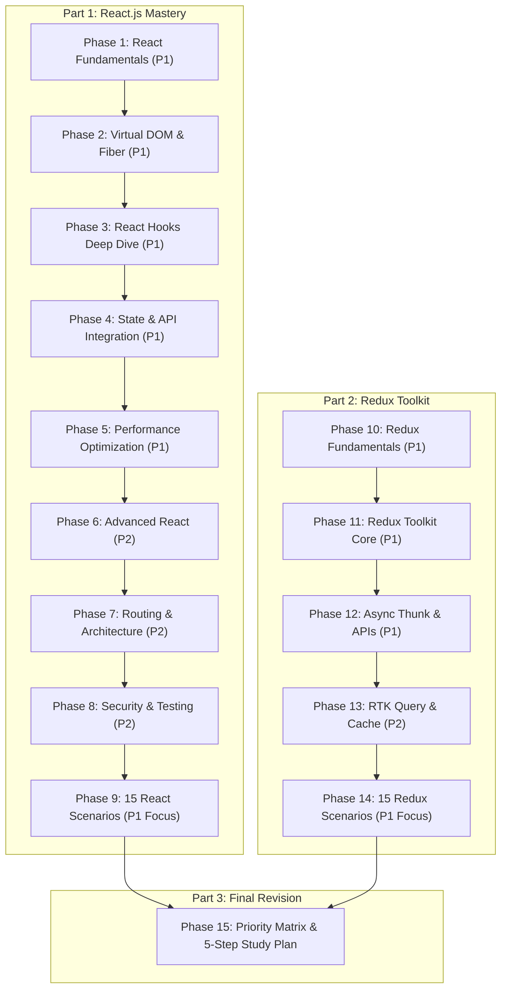
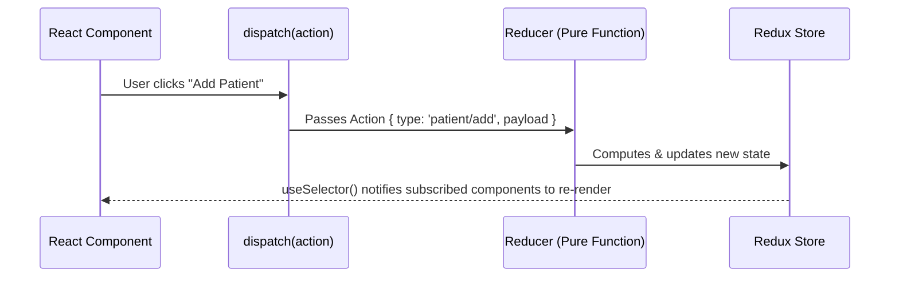

# ⚛️ React.js & Redux Toolkit Phased Master Revision Guide
> **Complete 15-Phase Interview Blueprint (4–5 Years Experience Level)**  
> *Aligned with the Interactive Deck: `react_slide_revision_deck.html` (207 Slides)*

---

## 📑 Roadmap Overview & Study Phasing



---

# Part 1 — React.js Mastery

## Phase 1: React Fundamentals (P1 · Must Prepare)
*Mapped to Slides 1–4, 9–16, 21–27, 27A, 27B*

### 1. What is React.js? Features and Role
- **Definition:** React is an open-source, component-based declarative JavaScript library for building interactive user interfaces for Single Page Applications (SPAs).
- **Core Pillars:**
  1. **Component-Based:** UI is split into reusable, independent atomic blocks.
  2. **Virtual DOM:** Fast reconciliation before touching the browser DOM.
  3. **Declarative Syntax:** You describe *what* the UI should look like based on state; React handles the DOM mutations.
  4. **Unidirectional Data Flow:** Data strictly flows top-down from parent to child via `props`.

### 2. Props vs State Comparison Matrix
| Feature | Props (`properties`) | State |
| :--- | :--- | :--- |
| **Origin** | Passed down by parent component | Initialized & managed internally inside component |
| **Mutability** | **Immutable** (Read-only for receiving component) | **Mutable** via setter function (`useState`) |
| **Re-render** | Yes, re-renders when parent passes new props | Yes, calling state setter triggers re-render |
| **Scope** | External interface / Component contract | Internal memory / Private component data |

### 3. Component Composition & State Lifting
- **State Lifting:** When two sibling components need to synchronize data, lift the state up to their closest common parent.
- **Children Prop:** Enables composition without deep prop drilling.
```jsx
function Card({ title, children }) {
  return (
    <div className="card">
      <h3>{title}</h3>
      {children}
    </div>
  );
}
```

---

## Phase 2: Virtual DOM, Fiber & Rendering — Complete Notes (P1 · High Priority)
*Mapped to Slides 6–8, 8A–8T in `react_slide_revision_deck.html`*

> **Yaad karne ka 5-Group Formula:**  
> `NAKSHA (3) ➔ COMPARE (2) ➔ ENGINE (5) ➔ BEHAVIOR (7) ➔ MODERN (2) = 19 Topics`

---

### 📘 GROUP 1: NAKSHA (VDOM)

#### 1.1 Real DOM vs Virtual DOM
- **Real DOM:** Browser ka actual HTML tree. Isme direct changes slow hote hain kyunki har change layout recalculation, repaint, aur reflow trigger karta hai.
- **Virtual DOM (VDOM):** Pure JavaScript object tree — Real DOM ka lightweight blue-print / **naksha** in-memory.
```jsx
// JSX:  <div className="box">Hi</div>
// VDOM:
{ type: 'div', props: { className: 'box', children: 'Hi' } }
```
- **Key Points:**
  - VDOM faster nahi hai, bas smart hai.
  - Minimal changes nikalta hai (diffing).
  - Declarative UI enable karta hai (developer sirf state define karta hai, DOM mutation nahi).
- **Real Life Analogy:** 🏛️ Ghar banane se pehle architect ka naksha — naksha par 10 baar pencil se badalna free hai, actual deewar todna mehenga hai!

#### 1.2 React Rendering Lifecycle
- **3 Core Steps:** `Trigger ➔ Render ➔ Commit`
  - **Trigger:** State change (`setCount(1)`) ya initial component mount.
  - **Render:** React compute karta hai ki kya badalna hai (pure calculations, VDOM diff).
  - **Commit:** React minimal changes ko Real DOM me physically apply karta hai.
- **Real Life Analogy:** 🍽️ Restaurant — Customer order deta hai (Trigger) ➔ Kitchen me chef prepare karta hai (Render) ➔ Waiter plate table par rakhta hai (Commit).

#### 1.3 Trigger ➔ Render ➔ Commit Deep-Dive
- **Trigger Phase:** `setCount(1)` ya props update task schedule karta hai.
- **Render Phase (Pausable, Pure):**
  - Naya VDOM banta hai.
  - Compare hota hai (Reconciliation & Diffing).
  - Fiber tree banti hai.
  - **Real DOM touch bilkul NAHI hota.**
- **Commit Phase (Sync, Side-effects):**
  - Real DOM changes apply hote hain.
  - `useLayoutEffect` synchronous execute hota hai.
  - **Ruk nahi sakta** (un-interruptible).
- **Paint ke baad:** Browser screen paint hone ke baad `useEffect` asynchronously chalta hai.
```text
Trigger ➔ Render (pausable) ➔ Commit (sync) ➔ Paint ➔ useEffect (async)
```
- **Real Life Analogy:** 💒 Shaadi — Planning list banao (Render - badal sakte ho) ➔ Mandap me pheras (Commit - ruk nahi sakta) ➔ Mehmaan party me aaye (useEffect).

---

### 📘 GROUP 2: COMPARE (Reconciliation)

#### 2.1 Reconciliation (3 Core Rules)
- **Matlab:** Purane VDOM vs naye VDOM ko compare karke minimal Real DOM changes nikalne ki process.
- **3 Heuristic Rules:**
  | Rule | Behavior | Example |
  | :--- | :--- | :--- |
  | **Different Element Type** | Pura subtree rebuild, state lost | `<div><Counter /></div>` ➔ `<span><Counter /></span>` |
  | **Same DOM Type** | Sirf attributes / props update | `<button className="blue" />` ➔ `<button className="red" />` |
  | **Same Component Type** | State preserve, new props pass | `<Counter count={1} />` ➔ `<Counter count={2} />` |
- **Real Life Analogy:** 📷 Purane aur naye photo ko spot-the-difference compare karna.

#### 2.2 Diffing Algorithm ($O(n)$ Heuristic)
- Traditional tree diffing $O(n^3)$ hota hai (1,000 nodes = 1 Billion operations!). React do assumptions se ise $O(n)$ linear banata hai:
  1. **Type different** ➔ Pura naya DOM tree banao aur purana delete karo.
  2. **Type same (HTML)** ➔ Sirf attributes update karo.
  3. **Type same (Component)** ➔ State preserve rakho, props update karke re-render karo.
  4. **Lists of children** ➔ Unique `key` prop se elements ko compare aur reorder karo.
- **Real Life Analogy:** 📄 Do documents ko page-by-page compare karna na ki har single word ko cross-compare karna.

---

### 📘 GROUP 3: ENGINE (Fiber)

#### 3.1 Fiber Architecture (The Need & Solution)
- **Kyun:** React 15 ka Stack Reconciler synchronous aur recursive tha. Large trees me main thread 100ms+ block ho jata tha (dropped frames & stutter).
- **Fiber Solution:** Rendering ko 5ms ke chhote chunks (units of work) me todna.
  - **Incremental:** Har component ka kaam alag Fiber unit me.
  - **Interruptible:** Render pause aur resume ho sakta hai taaki user inputs block na hon.
  - **Prioritized:** Urgent tasks (typing, clicks) ko non-urgent tasks (charts, lists) se aage priority milti hai.
- **Real Life Analogy:** 📖 Novel ek saans me nahi padhna — chapter-by-chapter padhna aur zaroori call aane par bookmark lagana!

#### 3.2 Fiber Node Structure & Traversal
- Har React element ke liye memory me ek JavaScript object banta hai:
```js
const fiberNode = {
  type: 'div',
  child: null,          // Pehla bachcha (first child)
  sibling: null,        // Agla bhai (next adjacent sibling)
  return: null,         // Baap node (parent fiber)
  dom: null,            // Real DOM node reference
  alternate: null,      // Double buffer link (Current <-> WIP)
  memoizedState: null,  // Hooks linked list
  memoizedProps: null,  // Old props
  flags: 0,             // PLACEMENT, UPDATE, DELETION
};
```
- **Traversal Order:** Child ➔ Sibling ➔ Return (`A ➔ B ➔ D ➔ E ➔ C`).
- **Real Life Analogy:** 🌳 Family tree — Pehle beta dekho (child) ➔ fir bhai (sibling) ➔ fir baap ke bhai par wapas jao (return).

#### 3.3 Current Tree vs Work-in-Progress Tree
- **Current Tree:** Jo is waqt screen par actively visible aur mounted hai (safe, read-only).
- **Work-in-Progress (WIP) Tree:** Background memory me render phase ke dauran build ho rahi tree (changes allowed).
```js
let currentRoot = null;   // Front buffer (Screen)
let wipRoot = null;       // Back buffer (Memory)

// Commit phase par:
currentRoot = wipRoot;    // 0ms instant pointer swap!
wipRoot = null;
```
- **Real Life Analogy:** 🏡 Ghar renovation — purana ghar rehne ke liye safe hai (Current), naya ghar alag plot par ban raha hai (WIP); tayyar hote hi chabi swap!

#### 3.4 Double Buffering
- **Concept:** Video game graphics se inspired architecture (Front Buffer vs Back Buffer).
  - **No Flicker:** Half-rendered elements screen par nahi aate.
  - **Safe Discard:** Urgent interrupt aane par WIP tree phenk do, existing UI untouched rehta hai.
  - **Node Reuse:** `alternate` pointer ke through memory re-use hoti hai (GC overhead reduce).
  - **Atomic Commit:** Single microsecond pointer switch se full UI update.
- **Real Life Analogy:** 📝 Exam me rough copy me calculation (WIP) ➔ final fair copy me neat answers (Current).

#### 3.5 Render Phase vs Commit Phase Matrix
| Parameter | Render Phase | Commit Phase |
| :--- | :--- | :--- |
| **Primary Kaam** | Compute karo (VDOM diff & Fiber tree) | Apply karo (Real DOM mutations) |
| **DOM Touch?** | **KABHI NAHI** (Zero DOM mutation) | **HAAN** (`document.createElement`, etc.) |
| **Pausable?** | **HAAN** (Interruptible & Time-sliced) | **NAHI** (Strictly synchronous) |
| **Side Effects?** | **NAHI** (Strictly pure functions) | **ALLOWED** (`useLayoutEffect`, refs) |
| **Hooks Flow** | Component body executes | `useLayoutEffect` (sync) ➔ Paint ➔ `useEffect` (async) |
| **Real Life** | Shaadi ki planning list | Mandap me actual rasam |

---

### 📘 GROUP 4: BEHAVIOR (I-K-R-P-B-A-S)

#### 4.1 Component Identity (I)
- **Rule:** `Same Type + Same Tree Position = Same Identity = State Preserved!`
- **Different Type:** `Different Type = Identity Lost = Component Destroyed + State Reset!`
```jsx
// Same Type at Same Position -> State PRESERVED:
isLoggedIn ? <Counter /> : <Counter />

// Different Type -> State DESTROYED:
isLoggedIn ? <Counter /> : <Display />
```
- **Real Life Analogy:** 👔 Same employee naye desk par baith gaya = wahi vyakti hai (state preserve); nayi post ka banda aaya = sab naya (state reset).

#### 4.2 Keys Ka Effect (K)
- **Array Index Key Bug:** List me se pehla item delete karne par index 0 agle item ko mil jata hai; React purane element ka DOM input state naye item pe chipka deta hai!
- **Safe Fix:** Hamesha permanent unique database ID (`key={item.id}`) use karo.
- **Real Life Analogy:** 🆔 Attendance hamesha permanent Aadhar number se lagao, temporary class roll number se nahi — ek student chhodega toh sabke roll numbers badal jayenge!

#### 4.3 Re-render Kab Aur Kyun Hota Hai (R)
- **4 Reasons Re-render Hota Hai:**
  1. **State Change:** `useState` setter call hua aur value change hui (`Object.is` check).
  2. **Parent Re-render:** Parent badla toh by default saare children re-render.
  3. **Context Change:** Consumed Context Provider ki value change hui.
  4. **Force Update:** Manual trigger.
- **Kab Re-render NAHI Hota:**
  - Same primitive value pass karne par (`setCount(count)` bailout).
  - Array/Object ko direct mutate karne par (`arr.push(x)` - same reference!).
- **Real Life Analogy:** 🔔 Calling bell — button dabaya toh ghanti baji; wahi switch already on hai toh dubara switch karne se naya sound nahi aayega.

#### 4.4 Parent vs Child Re-rendering (P)
- **Rule:** Parent re-render ➔ saare children by default re-render.
- **Myth Buster:** Child re-render hone ka matlab Real DOM repaint nahi hota; child ka function execute hoke naya VDOM banta hai.
- **Fix:** Child ko `React.memo(Child)` se wrap karo (shallow props compare karta hai).
- **Real Life Analogy:** 📢 Papa ne koi announcement ki — sab bachche dhyaan dete hain; lekin agar unka darwaza band hai (`React.memo`), toh unka dhyaan nahi bhatakta.

#### 4.5 State Batching in React 17 (B)
- **Batching:** Multiple `setState` calls ko merge karke 1 single re-render me execute karna.
- **React 17 Limitation:** Batching sirf React Synthetic Events (`onClick`, `onChange`) ke andar kaam karti thi.
- **Fail Area:** `setTimeout`, `setInterval`, Promises me har setter alag synchronous re-render trigger karta tha!
- **Real Life Analogy:** 🛒 Shopping list — Saari cheezein ek baar me khareed kar lana na ki har ek item ke liye alag se 5 baar market jana.

#### 4.6 Automatic Batching in React 18 (A)
- **React 18 Universal Batching:** React 18 me `setTimeout`, `fetch`, Promises, native listeners sabhi me multiple state updates 1 single render bante hain!
```jsx
// React 18: Har jagah Automatic Batching!
setTimeout(() => {
  setCount(1);
  setName('John'); // ✅ 1 single render (React 18)
}, 0);
```
- **Opt-out:** Agar immediately sync DOM read chahiye, `flushSync(() => setState())` use karo.
- **Real Life Analogy:** 🛵 Zomato — Chahe aapne 4 items alag-alag timing par cart me dale hon, delivery ek bundled order me aati hai.

#### 4.7 Synchronous vs Asynchronous State Updates (S)
- **setState is Async:** `setState` turant value badalta nahi, update schedule karta hai. Agli line par purani value hi milti hai.
- **Stale Closure Trap:** `setCount(count + 1)` 3 baar lagane par count sirf 1 badhega.
- **Safe Fix:** Functional update use karo: `setCount(prev => prev + 1)` jo latest queued state use karta hai.
- **Real Life Analogy:** 🏦 Bank — Saare transactions ek sath batch me process hote hain, har transaction previous valid balance pe calculate hoti hai.

---

### 📘 GROUP 5: MODERN

#### 5.1 Concurrent Rendering Fundamentals (C)
- **Interruptible Rendering:** React render work ko pause kar sakta hai agar koi urgent user input aaye.
- **Urgent vs Non-Urgent:** User typing = Urgent; Search list filter = Non-urgent transition.
- **Core APIs:**
  | Feature | Kaam |
  | :--- | :--- |
  | `startTransition` | Heavy update ko non-urgent mark karta hai |
  | `useTransition` | `isPending` loading flag deta hai |
  | `useDeferredValue` | Input value ka stale version retain karta hai |
  | `Suspense` | Loading fallback UI show karta hai |
- **Real Life Analogy:** 🍽️ Restaurant — Customer ko paani turant serve karo (Urgent), main dessert baad me prepare karo (Non-urgent).

#### 5.2 Strict Mode in Development (S)
- **Dev-only Tool:** Pure functions, memory leaks aur missing cleanups dhundhne ke liye.
- **Double Render (Dev):** Components ko 2 baar render karke check karta hai ki function strictly pure hai ya nahi.
- **Double Effect:** Effects ko `Mount ➔ Unmount ➔ Mount` run karke check karta hai ki cleanup function (`return () => ...`) theek se likha hai.
- **Zero Production Overhead:** Production build me StrictMode completely inactive rehta hai.
- **Real Life Analogy:** 🩺 Doctor patient ka checkup 2 baar alag-alag karta hai taaki koi complication miss na ho jaye.

---

### 🎯 MASTER SUMMARY TABLE — SAARE 19 TOPICS

| # | Group | Topic | Ek Line Core Funda | Real Life Analogy |
| :-: | :--- | :--- | :--- | :--- |
| **1** | **NAKSHA** | Real vs Virtual DOM | VDOM = In-memory JS object naksha; minimal diffing | Architect blueprint naksha |
| **2** | **NAKSHA** | Rendering Lifecycle | Trigger ➔ Render ➔ Commit 3-step sequence | Restaurant: order ➔ kitchen ➔ plate |
| **3** | **NAKSHA** | Trigger/Render/Commit | State trigger ➔ sochna (pausable) ➔ karna (sync) | Shaadi list ➔ mandap ➔ mehmaan |
| **4** | **COMPARE** | Reconciliation | Purane vs naye VDOM ka diff nikalna | Purane aur naye photo compare |
| **5** | **COMPARE** | Diffing Algorithm | $O(n)$ speed; type change = rebuild, keys = reorder | Document page-by-page compare |
| **6** | **ENGINE** | Fiber Architecture | Incremental 5ms chunks; pause, resume, prioritize | Novel padhna chapter-by-chapter |
| **7** | **ENGINE** | Fiber Node | child, sibling, return pointers se linked-list | Family tree traversal |
| **8** | **ENGINE** | Current vs WIP | Current = screen pe; WIP = background memory me | Ghar renovation alag plot |
| **9** | **ENGINE** | Double Buffering | 0ms atomic pointer swap; no screen flickering | Rough copy se fair sheet |
| **10** | **ENGINE** | Render vs Commit | Compute/Pausable vs DOM Mutation/Sync | Shaadi preparation vs actual rasam |
| **11** | **BEHAVIOR** | Identity (I) | Same type + position = preserve; else state reset | Same employee naya desk |
| **12** | **BEHAVIOR** | Keys Ka Effect (K) | Stable ID key zaroori; index key se state mixup | Attendance Aadhar se, roll no se nahi |
| **13** | **BEHAVIOR** | Re-render (R) | State, parent, context changes; skipped on same ref | Calling bell push |
| **14** | **BEHAVIOR** | Parent-Child (P) | Parent renders ➔ all children render; block via memo | Family announcement |
| **15** | **BEHAVIOR** | Batching (B) | React 17 me sirf synthetic events me batching | Shopping list ek baar me lana |
| **16** | **BEHAVIOR** | Auto Batch (A) | React 18 me promises, timeouts har jagah batching | Zomato bundled delivery |
| **17** | **BEHAVIOR** | Sync/Async (S) | setState scheduled update; use `prev => prev + 1` | Bank batch settlement |
| **18** | **MODERN** | Concurrent (C) | Interruptible UI; urgent vs non-urgent transitions | Restaurant me paani vs dessert |
| **19** | **MODERN** | StrictMode (S) | Dev-only tool; double render & double effect cleanups | Doctor ka 2-baar checkup |

---

## Phase 3: React Hooks (P1 · Very Important)
*Mapped to Slides 65–76, 76A–76C*

### 1. Rules of Hooks
1. **Only Call at Top Level:** Never call hooks inside loops, conditional statements, or nested functions.
2. **Only Call from React Functions:** Only call hooks inside React functional components or custom hooks.

### 2. useState & Functional Updates
```jsx
// Stale closure bug:
setCount(count + 1); // If called 3 times, count increases by only 1!

// Safe functional update:
setCount(prev => prev + 1); // Guarantees latest queued state!
```

### 3. useEffect & Dependency Array Scenarios
- `useEffect(fn)`: Runs after **every** render.
- `useEffect(fn, [])`: Runs **only once** on mount; cleanup runs on unmount.
- `useEffect(fn, [propA, stateB])`: Runs on mount and whenever `propA` or `stateB` change by referential equality (`Object.is`).

### 4. Hook Comparison Matrix
| Hook | What It Caches / Returns | Triggers Re-render? | Typical Use Case |
| :--- | :--- | :--- | :--- |
| `useState` | State value + setter function | **Yes** (when setter called) | Data that directly controls UI rendering |
| `useRef` | Mutable object `{ current: val }` | **No** | DOM nodes, timer IDs, previous state storage |
| `useMemo` | Cached return value of a function | **No** | Expensive computations ($O(N^2)$), memoized objects |
| `useCallback`| Cached function definition | **No** | Stable callback references passed to memoized children |

---

## Phase 4: State Management & API Integration (P1)
*Mapped to Slides 77–81, 81A, 119, 121*

### 1. Prop Drilling vs Context API
- **Prop Drilling:** Passing props through 5–10 intermediate components that don't need the data themselves just to deliver it to a leaf node.
- **Context API:** Provides global dependency injection (`createContext`, `Provider`, `useContext`) without prop drilling.

### 2. API Race Conditions & AbortController
```jsx
useEffect(() => {
  const controller = new AbortController();

  async function fetchPatientData() {
    try {
      const res = await fetch(`/api/patients/${patientId}`, { signal: controller.signal });
      const data = await res.json();
      setPatient(data);
    } catch (err) {
      if (err.name !== 'AbortError') setError(err.message);
    }
  }

  fetchPatientData();
  return () => controller.abort(); // Cancels previous pending request!
}, [patientId]);
```

---

## Phase 5: Performance Optimization — Complete Hindi Guide (P1 · High Priority)
*Mapped to Slides 102–112, 123, 124, 124A & Performance Scenarios*

### 1. Performance Optimization — Introduction
- **Kya hai:** React app ko aise banana ki kam se kam unnecessary re-renders hon, kam se kam Real DOM updates hon, aur user ko buttery-smooth 60 FPS experience mile.
- **Kab zaroorat hai:** Jab app laggy feel ho, input me typing slow ho, scroll janky/stutter kare, ya React DevTools Profiler me heavy components highlight hon.
- **Kyun zaroorat hai:** React fast hai, lekin galat architectural patterns app ko slow kar dete hain. Low-end mobile devices par yeh aur zyada noticeable hota hai (slow CPU, limited RAM).
- **Kaise karein:** Pehle measure karo (Profiler, DevTools), phir sirf wahi optimize karo jo actually slow hai. Premature optimization se sirf code complexity badhti hai.
- **Golden Rule:**
```text
┌─────────────────────────────────────────────┐
│    1. MEASURE   →   2. IDENTIFY  →   3. FIX │
│    (Profiler)        (Culprit)     (Optimize)│
│                                             │
│    Bina measure kiye optimize = Andha kaam ❌│
└─────────────────────────────────────────────┘
```

---

### 2. The 4 Re-render Triggers
- **Kya hai:** React component sirf 4 specific reasons se re-render hota hai:
```text
┌─────────────────────────────────────────────────────────────┐
│                    4 RE-RENDER TRIGGERS                     │
│                                                             │
│ 1. STATE CHANGE                                             │
│    useState setter / useReducer dispatch                    │
│    ┌──────────┐                                             │
│    │ setCount │──► Component re-render                      │
│    └──────────┘                                             │
│                                                             │
│ 2. PARENT RE-RENDER                                         │
│    Parent render hua → child bhi render (jab tak memo na ho)│
│    ┌────────┐                                               │
│    │ Parent │──► ┌───────┐                                  │
│    └────────┘    │ Child │──► re-render                     │
│                  └───────┘                                  │
│                                                             │
│ 3. CONTEXT CHANGE                                           │
│    Context value badla → saare consumers re-render          │
│    ┌──────────┐                                             │
│    │ Provider │──► ┌──────────┐                             │
│    └──────────┘    │Consumer 1│──► re-render                │
│                    │Consumer 2│──► re-render                │
│                    │Consumer 3│──► re-render                │
│                    └──────────┘                             │
│                                                             │
│ 4. FORCE UPDATE                                             │
│    forceUpdate() / reducer trick                            │
│    ┌──────────────┐                                         │
│    │forceUpdate() │──► re-render (bypass bailout)           │
│    └──────────────┘                                         │
└─────────────────────────────────────────────────────────────┘
```
- **Important Baat:** `Re-render ≠ DOM update`. Re-render ka matlab sirf component function ka dobara execute hona hai. Agar output VDOM same hai, React Real DOM ko touch nahi karta.
- **Kab dhyan dena:** Jab ek chhota sa state change poore page ke deep tree ko unnecessary re-render kar raha ho.
- **Kaise handle karein:** State ko local rakho (colocation), `React.memo`, context splitting, aur children prop pattern use karo.

---

### 3. Re-render Flow — Kya Hota Hai
```text
STATE CHANGE
     │
     ▼
┌──────────────────┐
│  Component fn    │ ← Aapka code dobara chalta hai
│  dobara chalta   │
└────────┬─────────┘
         │
         ▼
┌──────────────────┐
│ Naya Virtual DOM │ ← Naye JS objects bante hain
│   tree banta     │
└────────┬─────────┘
         │
         ▼
┌──────────────────┐
│ Purane se DIFF   │ ← Reconciliation (Diffing algorithm)
│      karo        │
└────────┬─────────┘
         │
   ┌─────┴─────┐
   │           │
 SAME      DIFFERENT
   │           │
   ▼           ▼
┌──────┐  ┌──────────┐
│ SKIP │  │   DOM    │ ← Sirf badle huye part pe
│ DOM  │  │  UPDATE  │   Real DOM mutation!
└──────┘  └──────────┘
```
- **Key Insight:** Re-render hone ka matlab direct DOM update nahi hota. Lekin re-render khud CPU cycles consume karta hai (function call execution, garbage collection, and diffing calculation).

---

### 4. React.memo / useMemo / useCallback
- **Kya hai:**
```text
┌─────────────────────────────────────────────────────────────┐
│                    3 MEMOIZATION TOOLS                      │
│                                                             │
│ React.memo  ──► Component ko wrap karta hai                 │
│                 Props shallow-equal → re-render SKIP        │
│                                                             │
│ useMemo     ──► Value/computation result cache karta hai    │
│                 Deps same → dobara calculate NAHI           │
│                                                             │
│ useCallback ──► Function reference stable rakhta hai        │
│                 Deps same → naya function reference NAHI    │
└─────────────────────────────────────────────────────────────┘
```
- **Kab Use Karein:**
| Tool | Kab Use Karein |
| :--- | :--- |
| `React.memo` | Child component ko same props baar-baar mil rahe hon aur child expensive ho |
| `useMemo` | Heavy calculations ($O(N^2)$ sort/filter) ya memoized child ko object/array prop pass karte waqt |
| `useCallback` | Memoized child ko callback function prop pass karte waqt ya `useEffect` dependency me function hone par |
- **Kyun:** Bina memoization ke har render naya object/function banata hai. `Object.is` check fail ho jata hai aur `React.memo` bypass ho jata hai.
- **Kaise:**
```jsx
const Child = React.memo(function Child({ onClick }) { ... });
const handleClick = useCallback(() => doThing(id), [id]);
const sorted = useMemo(() => list.sort(cmp), [list]);
```
> [!WARNING]
> Overuse mat karo! Har `useMemo`/`useCallback` memory + comparison cost leta hai. Sirf measured hotspots pe lagao.

---

### 5. Memoization Flow Diagram
```text
BINA MEMOIZATION:
─────────────────
Parent render
     │
     ▼
┌─────────────┐
│ Naya object │ ← { a: 1 } har baar naya memory reference
│   banaya    │
└──────┬──────┘
       │
       ▼
┌─────────────┐
│ Child props │ ← Reference different!
│   compare   │   Object.is(old, new) = false
└──────┬──────┘
       │
       ▼
┌─────────────┐
│    Child    │ ← Child re-render ho gaya ❌
│  re-render  │
└─────────────┘

MEMOIZATION KE SAATH:
─────────────────────
Parent render
     │
     ▼
┌─────────────┐
│ useMemo se  │ ← Same memory reference return hua
│ same object │
└──────┬──────┘
       │
       ▼
┌─────────────┐
│ Child props │ ← Reference strictly same!
│   compare   │   Object.is(old, new) = true
└──────┬──────┘
       │
       ▼
┌─────────────┐
│    Child    │ ← Re-render SKIP ho gaya ✅
│    skip     │
└─────────────┘
```

---

### 6. Reference Equality & Object.is
- **Kya hai:** React dependency comparison aur state bailout ke liye `Object.is` use karta hai, `===` nahi:
```text
┌─────────────────────────────────────────────────────────────┐
│                     Object.is BEHAVIOR                      │
│                                                             │
│ Object.is(NaN, NaN)  → true  (=== deta hai false)           │
│ Object.is(0, -0)     → false (=== deta hai true)            │
│ Object.is({}, {})    → false ← ⚠️ HAR RENDER NAYA OBJECT    │
│ Object.is([], [])    → false ← ⚠️ HAR RENDER NAYI ARRAY     │
│ Object.is(fn1, fn2)  → false ← ⚠️ HAR RENDER NAYA FN        │
│ Object.is(5, 5)      → true  ← Primitives safe              │
│ Object.is('a', 'a')  → true  ← Primitives safe              │
└─────────────────────────────────────────────────────────────┘
```
- **Kab dhyan dena:** Jab `useEffect` infinite loop me chala jaye ya `React.memo` kaam na kare.
- **Kyun important:** React reference compare karta hai, deep values nahi. Naya object = naya reference = memo fail.
- **Kaise fix karein:**
```jsx
// ❌ New object every render (Memo todta hai):
<Child config={{ a: 1 }} />

// ✅ Stable reference:
const config = useMemo(() => ({ a: 1 }), []);
<Child config={config} />
```

---

### 7. Context Re-render Problem
- **Kya hai:** Jab Context Provider ki value change hoti hai, us context ke saare consumers re-render hote hain — chahe woh sirf ek un-related field use karte hon.
```text
┌─────────────────────────────────────────────────────────────┐
│                 CONTEXT RE-RENDER PROBLEM                   │
│                                                             │
│       ┌──────────────────────────────────────┐              │
│       │ <Ctx.Provider value={{user, theme}}>│              │
│       │                                      │              │
│       │ Har render pe NAYA OBJECT banta hai  │              │
│       └──────────────────┬───────────────────┘              │
│                          │                                  │
│             ┌────────────┼────────────┐                     │
│             │            │            │                     │
│             ▼            ▼            ▼                     │
│       ┌──────────┐ ┌──────────┐ ┌──────────┐                │
│       │Consumer A│ │Consumer B│ │Consumer C│                │
│       │  (user)  │ │ (theme)  │ │  (user)  │                │
│       └────┬─────┘ └────┬─────┘ └────┬─────┘                │
│            │            │            │                      │
│            ▼            ▼            ▼                      │
│        RE-RENDER    RE-RENDER    RE-RENDER                  │
│         (theme        (user        (theme                   │
│         change       change        change                   │
│         pe bhi)      pe bhi)       pe bhi)                  │
│                                                             │
│  ⚠️ Sab consumers re-render, chahe relevant value na badli  │
└─────────────────────────────────────────────────────────────┘
```
- **3 Solutions:**
  1. **Context Splitting:** Ek monolithic context ki jagah 3 fine-grained contexts banao (`UserCtx`, `ThemeCtx`, `CartCtx`).
  2. **Memoize Provider Value:** Provider value ko `useMemo` se wrap karo.
  3. **State + Dispatch Alag Karo:** State context aur Updater/Dispatch context alag karo (Dispatch stable rehta hai).

---

### 8. Context Splitting — Diagram
```text
PEHLE (❌ Ek bada monolithic context):
─────────────────────────────────────
┌─────────────────────────────────────────┐
│ <AppCtx value={{user, theme, cart, ...}}>│
│                                         │
│ theme change → SABHI CONSUMERS RE-RENDER│
└─────────────────────────────────────────┘

AB (✅ Split contexts):
──────────────────────
┌─────────────────┐
│ <UserCtx>       │
│   <ThemeCtx>    │
│     <CartCtx>   │
│       <App/>    │
│     </CartCtx>  │
│   </ThemeCtx>   │
│ </UserCtx>      │
└─────────────────┘
Theme change → Sirf ThemeCtx consumers re-render ✅
User consumers untouched ✅
Cart consumers untouched ✅
```

---

### 9. State Colocation & Move State Down
- **Kya hai:** State ko us component ke jitna paas ho sake rakho jahan woh actually use hoti hai.
```text
PEHLE (❌ State upar lifted):
────────────────────────────
┌─────────────────────────────┐
│ Page                        │
│ ├─ const [open, setOpen]    │ ← Modal state upar
│ │                           │
│ ├─ <HeavyList />            │ ← Modal toggle pe ye bhi re-render ❌
│ └─ <Modal open={open} />    │
└─────────────────────────────┘

AB (✅ State neeche colocated):
──────────────────────────────
┌─────────────────────────────┐
│ Page                        │
│ ├─ <HeavyList />            │ ← Ab re-render nahi hoga ✅
│ └─ <ModalWrapper />         │
│    └─ const [open, ...]     │ ← State isolated andar
│       <Modal open={open}/>  │
└─────────────────────────────┘
```
- **Code:**
```jsx
// ❌ State lifted up needlessly:
function Page() {
  const [open, setOpen] = useState(false);
  return <><HeavyList /><Modal open={open} /></>;
}

// ✅ State in small wrapper (Colocated):
function Page() {
  return <><HeavyList /><ModalWrapper /></>;
}
```

---

### 10. children Prop Pattern
- **Kya hai:** Static expensive component ko `children` prop ke form me pass karna. Kyunki children parent ke bahar bante hain, unki identity stable rehti hai.
```jsx
// ❌ Unoptimized:
function Parent() {
  const [count, setCount] = useState(0);
  return (
    <div>
      <button onClick={() => setCount(c => c + 1)}>{count}</button>
      <ExpensiveTree /> {/* Parent render pe ye bhi re-render ❌ */}
    </div>
  );
}

// ✅ Optimized with children pattern:
function Parent({ children }) {
  const [count, setCount] = useState(0);
  return (
    <div>
      <button onClick={() => setCount(c => c + 1)}>{count}</button>
      {children} {/* Re-render nahi hoga ✅ */}
    </div>
  );
}

function App() {
  return (
    <Parent>
      <ExpensiveTree />
    </Parent>
  );
}
```

---

### 11. Code Splitting — React.lazy, Suspense, import()
- **Kya hai:** Monolithic bundle ko chhote on-demand chunks me todna.
```text
BINA CODE SPLITTING:
────────────────────
┌─────────────────────────────┐
│ bundle.js (2.5MB)           │
│ ├─ Home                     │
│ ├─ About                    │
│ ├─ Dashboard                │
│ ├─ Chart (heavy)            │
│ └─ PDF Editor (heavy)       │
└─────────────────────────────┘
        │
        ▼
Sab ek sath download ❌ (Slow First Paint)

CODE SPLITTING KE SAATH:
────────────────────────
┌──────────────┐
│ bundle.js    │ ← 350KB initial bundle
│ ├─ Home      │
│ └─ Router    │
└──────┬───────┘
       ├──► chunk-about.js (lazy on-demand)
       ├──► chunk-dash.js  (lazy on-demand)
       ├──► chunk-chart.js (lazy on-demand)
       └──► chunk-pdf.js   (lazy on-demand)
Sirf zaroori code pehle load hota hai ✅ (Fast First Contentful Paint)
```
- **Kaise:**
```jsx
const Chart = React.lazy(() => import('./Chart'));

<Suspense fallback={<Spinner />}>
  <Chart />
</Suspense>
```

---

### 12. Route-Based Splitting
- **Kya hai:** Har application route ko alag independent JS chunk me split karna. Single biggest win for bundle size reduction!
```jsx
import { lazy, Suspense } from 'react';
import { Routes, Route } from 'react-router-dom';

const Home = lazy(() => import('./routes/Home'));
const About = lazy(() => import('./routes/About'));
const Dashboard = lazy(() => import('./routes/Dashboard'));

function App() {
  return (
    <Suspense fallback={<PageLoader />}>
      <Routes>
        <Route path="/" element={<Home />} />
        <Route path="/about" element={<About />} />
        <Route path="/dashboard" element={<Dashboard />} />
      </Routes>
    </Suspense>
  );
}
```

---

### 13. List Virtualization
- **Kya hai:** Sirf visible viewport rows ko DOM me render karna (baaki 9,970 rows DOM me banti hi nahi).
```text
BINA VIRTUALIZATION (❌):
─────────────────────────
┌─────────────────────────┐
│ Viewport (600px)        │
│ ┌───────────────────┐   │
│ │ Row 0             │   │ ┐
│ │ Row 1             │   │ │ Visible
│ │ Row 2             │   │ │ (~30 rows)
│ │ ...               │   │ │
│ │ Row 29            │   │ ┘
│ └───────────────────┘   │
│                         │
│ DOM me 10,000 nodes ❌   │ (Browser freezing, high RAM)
└─────────────────────────┘

VIRTUALIZATION KE SAATH (✅):
─────────────────────────────
┌─────────────────────────┐
│ Viewport (600px)        │
│ ┌───────────────────┐   │
│ │ Row 0             │   │ ┐
│ │ Row 1             │   │ │ Sirf ~30
│ │ Row 2             │   │ │ nodes DOM me!
│ │ ...               │   │ │
│ │ Row 29            │   │ ┘
│ └───────────────────┘   │
│                         │
│ Baaki rows render hi    │
│ nahi hote ✅             │
└─────────────────────────┘
Scroll karte waqt rows recycle/swap hote hain!
```
- **Libraries:** `react-window` (lightweight), `@tanstack/react-virtual`.
```jsx
import { FixedSizeList } from 'react-window';

<FixedSizeList height={600} itemCount={10000} itemSize={35} width="100%">
  {({ index, style }) => <div style={style}>Row #{index}</div>}
</FixedSizeList>
```

---

### 14. key Prop — Why Index Is Bad
- **Kya hai:** `key` React ko batata hai ki renders ke dauran elements ko unki identity ke sath kaise match aur track karna hai.
```text
INDEX KEY BUG (❌):
──────────────────
Purani List:            Nayi List (X insert top pe):
┌──────┬──────┬──────┐  ┌──────┬──────┬──────┬──────┐
│key:0 │key:1 │key:2 │  │key:0 │key:1 │key:2 │key:3 │
│  A   │  B   │  C   │  │  X   │  A   │  B   │  C   │
└──────┴──────┴──────┘  └──────┴──────┴──────┴──────┘
React match karta hai:
key 0: A → X (Content badla, DOM reuse)
key 1: B → A (Content badla, DOM reuse)
key 2: C → B (Content badla, DOM reuse)
key 3: new mount
⚠️ State, focus aur input values galat row pe chipak jaate hain!

STABLE ID KEY (✅):
───────────────────
Purani List:            Nayi List:
┌──────┬──────┬──────┐  ┌──────┬──────┬──────┬──────┐
│id:A  │id:B  │id:C  │  │id:X  │id:A  │id:B  │id:C  │
│  A   │  B   │  C   │  │  X   │  A   │  B   │  C   │
└──────┴──────┴──────┘  └──────┴──────┴──────┴──────┘
React match karta hai:
id X: Naya mount
id A: Same node preserved (State safe ✅)
id B: Same node preserved ✅
id C: Same node preserved ✅
```

---

### 15. Profiler API — `<React.Profiler>`
- **Kya hai:** Ek native React component jo kisi bhi subtree ke exact render duration ko programmatic measure karta hai.
```jsx
<Profiler id="PatientList" onRender={(id, phase, actualDuration, baseDuration) => {
  console.log({ id, phase, actualDuration, baseDuration });
}}>
  <PatientList />
</Profiler>
```
- `actualDuration`: Current render me spend hua actual time (with memoization).
- `baseDuration`: Agar koi memoization na hoti toh lagne wala hypothetical time.
- **Rule:** Agar `actualDuration ≈ baseDuration`, toh aapki memoization kaam nahi kar rahi!

---

### 16. React DevTools — "Why did this render?"
1. React Developer Tools extension install karo.
2. **Profiler** tab kholo.
3. Gear icon (Settings) ➔ **"Record why each component rendered"** checkbox tick karo.
4. Record interaction ➔ Commit inspect karo.
5. Direct reasons dikhenge:
   - *"Props changed: onClick"*
   - *"State changed: count"*
   - *"Parent re-rendered"*
   - *"Context changed: theme"*

---

### 17. Render Props vs Hooks — Performance
```text
RENDER PROPS:
─────────────
<DataFetcher>
  {data => (
    <Table rows={data} />  ← Har render par inline function creation
  )}                       ← Extra component boundary & nested pyramid
</DataFetcher>

HOOKS:
──────
const data = useFetch();   ← Direct flat execution
return <Table rows={data} />; ← Zero extra nesting, deps array control
```
- **Verdict:** Hooks generally faster, cleaner aur simpler hote hain (Zero wrapper overhead).

---

### 18. Debouncing & Throttling
```text
┌─────────────────────────────────────────────────────────────┐
│ DEBOUNCE ──► Event rukne ke N ms baad ek baar chalao       │
│ Typing: a-b-c-d-e                                           │
│ ┌─┐┌─┐┌─┐┌─┐┌─┐                                             │
│ └─┘└─┘└─┘└─┘└─┘                                             │
│  │  │  │  │  └──► 300ms baad 1 single API call ✅           │
│  │  │  │  └─────► Cancelled                                 │
│  │  │  └────────► Cancelled                                 │
│  │  └───────────► Cancelled                                 │
│  └──────────────► Cancelled                                 │
│                                                             │
│ THROTTLE ──► Max once per N ms                              │
│ Scroll: ▓▓▓▓▓▓▓▓▓▓▓▓▓▓▓▓▓▓▓▓▓▓▓▓▓▓▓▓▓▓▓▓▓▓▓▓▓▓▓▓▓           │
│         ▼          ▼          ▼          ▼                  │
│       100ms      200ms      300ms      400ms  (Fixed rate)  │
└─────────────────────────────────────────────────────────────┘
```
- **Code (Debounce in useEffect):**
```jsx
useEffect(() => {
  const timer = setTimeout(async () => {
    const res = await fetch(`/api/search?q=${query}`);
    const data = await res.json();
    setResults(data);
  }, 300);

  return () => clearTimeout(timer); // Cleanup cancels pending call!
}, [query]);
```

---

### 19. Web Workers
- **Kya hai:** Browser ka background multi-threading thread jo main UI thread ko freeze kiye bina 500ms+ ka heavy computation execute karta hai.
```text
BINA WEB WORKER:
────────────────
Main Thread: [UI]──[HEAVY PARSE 500ms]──[UI Frozen ❌]
Buttons click nahi hote, animations freeze!

WEB WORKER KE SAATH:
────────────────────
Main Thread:   [UI]──[UI]──[UI]──[UI]──[UI] (Smooth 60 FPS ✅)
Worker Thread: [HEAVY PARSE 500ms]
                     │
                     └──► postMessage(result) ──► Main Thread receives
```
```jsx
useEffect(() => {
  const worker = new Worker(new URL('./parser.worker.js', import.meta.url));
  worker.postMessage(largeDataSet);
  worker.onmessage = (e) => setCalculatedData(e.data);
  return () => worker.terminate();
}, [largeDataSet]);
```

---

### 20. startTransition (React 18)
- **Kya hai:** React ko batana ki koi state update non-urgent (low priority) hai taaki urgent user keystrokes pehle process hon:
```jsx
import { useTransition } from 'react';

const [isPending, startTransition] = useTransition();

const handleInputChange = (e) => {
  // Urgent update: Input box types instantly!
  setInputVal(e.target.value);

  // Non-urgent transition: Heavy 10,000 item list filtering
  startTransition(() => {
    setFilteredList(heavyFilter(e.target.value));
  });
};
```

---

### 21. useDeferredValue
- **Kya hai:** Kisi value ka deferred copy return karta hai. Jab tak naya render background me complete na ho, React purani value render karta hai bina user input ko freeze kiye.
```jsx
function SearchResults({ query }) {
  const deferredQuery = useDeferredValue(query);
  const isStale = query !== deferredQuery;

  const list = useMemo(() => filterItems(deferredQuery), [deferredQuery]);

  return (
    <div style={{ opacity: isStale ? 0.6 : 1 }}>
      <List items={list} />
    </div>
  );
}
```
| Hook | Kab Use Karein |
| :--- | :--- |
| `startTransition` | Jab aapke paas state setter function ka direct access ho |
| `useDeferredValue` | Jab value parent se prop ke form me aa rahi ho |

---

### 22. Complete Performance Optimization Workflow
```text
┌─────────────────────────────────────────────────────────────────┐
│                    OPTIMIZATION WORKFLOW                        │
│                                                                 │
│  1. MEASURE                                                     │
│     ┌──────────────────────────────────────┐                    │
│     │ React DevTools Profiler              │                    │
│     │ "Record why each component rendered" │                    │
│     │ <React.Profiler> metrics             │                    │
│     └──────────────────┬───────────────────┘                    │
│                        │                                        │
│                        ▼                                        │
│  2. IDENTIFY                                                    │
│     ┌──────────────────────────────────────┐                    │
│     │ Kaunsa component slow hai?           │                    │
│     │ Kyun baar-baar render ho raha?       │                    │
│     │ Root cause identify karo             │                    │
│     └──────────────────┬───────────────────┘                    │
│                        │                                        │
│                        ▼                                        │
│  3. FIX (Choose targeted solution)                              │
│     ┌──────────────────────────────────────┐                    │
│     │ Same props → React.memo              │                    │
│     │ Callback prop → useCallback          │                    │
│     │ Object prop → useMemo                │                    │
│     │ Context → Split + memoize            │                    │
│     │ State upar → Colocate / move down    │                    │
│     │ Static subtree → children pattern    │                    │
│     │ Big list → Virtualize (react-window) │                    │
│     │ Big bundle → lazy + route split      │                    │
│     │ Heavy compute → Web Worker           │                    │
│     │ Laggy typing → startTransition       │                    │
│     └──────────────────┬───────────────────┘                    │
│                        │                                        │
│                        ▼                                        │
│  4. RE-MEASURE                                                  │
│     ┌──────────────────────────────────────┐                    │
│     │ Profiler dobara chalao               │                    │
│     │ FPS & duration improvement verify    │                    │
│     │ Agar fayda nahi hua → Revert code    │                    │
│     └──────────────────────────────────────┘                    │
└─────────────────────────────────────────────────────────────────┘
```

---

### 23. Quick Decision Cheat-Sheet
| Problem | Target Solution |
| :--- | :--- |
| Child same props pe unnecessary re-render ho raha hai | `React.memo` |
| Function prop har render naya reference banakar memo todta hai | `useCallback` |
| Object/array prop naya reference banakar memo todta hai | `useMemo` |
| Context Provider update hone par saare consumers re-render | Context Splitting + Value memoization |
| Input type karne par poora page re-render hota hai | State Colocation (Move State Down) |
| Parent ke render par static subtree unnecessary chalta hai | `children` prop composition pattern |
| 1,000+ items ki table/list scroll karte waqt laggy hai | List Virtualization (`react-window`) |
| List item reorder/delete karne par form state mix ho jati hai | Stable unique ID `key={item.id}` (Index key nahi!) |
| Heavy filtering ke waqt input typing stutter/laggy hoti hai | `startTransition` / `useDeferredValue` |
| Bada JavaScript initial bundle first paint slow karta hai | `React.lazy` + Route-based code splitting |
| CPU-heavy synchronous computation UI freeze kar raha hai | Web Worker |
| Lag ka actual culprit dhundhna hai | React DevTools Profiler ("Record why rendered") |
| Har single keystroke par backend API hit ho rahi hai | Debouncing (300ms) |
| Scroll ya window resize par continuous handler trigger | Throttling |

---

### 24. Final Summary Diagram
```text
┌─────────────────────────────────────────────────────────────────┐
│            PERFORMANCE OPTIMIZATION — FULL PICTURE              │
│                                                                 │
│  ┌──────────────────────────────────────────────────────────┐   │
│  │ PROBLEM SOURCES:                                         │   │
│  │ 1. Reference equality fail (Object.is check fail)        │   │
│  │ 2. Top-down component tree cascading re-renders          │   │
│  │ 3. Monolithic context blast radius                       │   │
│  │ 4. Single-threaded main thread blocking                  │   │
│  │ 5. Heavy initial JS bundle size                          │   │
│  │ 6. Huge DOM tree reconciliation cost                     │   │
│  └──────────────────────┬───────────────────────────────────┘   │
│                         │                                       │
│                         ▼                                       │
│  ┌──────────────────────────────────────────────────────────┐   │
│  │ SOLUTIONS:                                               │   │
│  │ Memoization ──► React.memo, useMemo, useCallback         │   │
│  │ Context     ──► Split contexts, memoize provider values  │   │
│  │ Tree        ──► State colocation, children pattern       │   │
│  │ Lists       ──► Virtualize (react-window), stable keys   │   │
│  │ Bundle      ──► React.lazy, Suspense, Route splitting    │   │
│  │ Threads     ──► Web Workers                              │   │
│  │ Priority    ──► startTransition, useDeferredValue        │   │
│  │ Events      ──► Debouncing, Throttling                   │   │
│  │ Verification──► Profiler ("Why did this render?")        │   │
│  └──────────────────────┬───────────────────────────────────┘   │
│                         │                                       │
│                         ▼                                       │
│  ┌──────────────────────────────────────────────────────────┐   │
│  │ RESULT:                                                  │   │
│  │ ✅ Buttery-smooth 60 FPS UI                              │   │
│  │ ✅ Instant input responsiveness                          │   │
│  │ ✅ Fast First Contentful Paint                           │   │
│  │ ✅ Low memory footprint                                  │   │
│  │ ✅ Production-ready Enterprise Architecture              │   │
│  └──────────────────────────────────────────────────────────┘   │
└─────────────────────────────────────────────────────────────────┘
```

---

### 25. Core Principles (The Root)
| Core Principle | Kaam / Significance |
| :--- | :--- |
| **Reference Equality** | `Object.is` comparison — immutable references hi memoization ka base hain |
| **Render-Reconcile-Commit** | Pure render calculation vs DOM physical mutation ka separation |
| **Component Tree Top-Down** | Parent re-render cascades down until blocked by `memo` |
| **Single-Threaded JS** | Heavy CPU work freezes the event loop — delegate to Web Workers |
| **Reconciliation Cost** | 10,000 DOM nodes take heavy diffing — virtualize to only ~30 visible rows |
| **Bundle Size** | Byte size delays First Contentful Paint — split via dynamic `import()` |

---

### 26. Golden Rule & Ek Line Me
```text
┌─────────────────────────────────────────────────────────────┐
│                                                             │
│           PEHLE MEASURE KARO, PHIR OPTIMIZE KARO            │
│                                                             │
│   ❌ Premature optimization:                                │
│      → Code complexity badhti hai                           │
│      → Memory comparison overhead se app aur slow ho sakti  │
│      → Codebase maintain karna mushkil ho jata hai          │
│                                                             │
│   ✅ Measure → Identify → Fix → Re-measure:                │
│      → Sirf actual slow hotspots par focus                  │
│      → Evidence-based quantifiable performance gains        │
│      → Clean, robust, readable code                         │
│                                                             │
└─────────────────────────────────────────────────────────────┘
```

> **📌 Ek Line Me:**  
> **Phase 5 ka core:** 4 re-render triggers ko samjho ➔ measure karo Profiler se ➔ reference equality ka concept samjho ➔ memoization, context splitting, state colocation, children pattern, virtualization, code splitting, Web Workers, aur transitions se targeted fix karo ➔ re-measure karke verify karo. Sab ka root = **Reference Equality + Component Tree + Single Thread**!

---

## Phase 6 to Phase 8: Advanced Concepts, Routing, Security & Testing (P2)
*Mapped to Slides 28–64, 82–101, 113–118, 120, 122*

- **Routing (React Router v6):** `BrowserRouter`, `<Routes>`, `<Route path="/patients/:id" element={<PatientDetails />} />`, `useParams()`, `useNavigate()`.
- **Protected Routes:** Higher-Order Wrapper component checking auth token before rendering `<Outlet />`.
- **Security:**
  - Never use `dangerouslySetInnerHTML` without sanitizing with `DOMPurify` to avoid XSS.
  - Store JWT auth tokens in `httpOnly` secure cookies to prevent JavaScript access.
- **Testing:** React Testing Library (RTL) focuses on testing user behavior rather than internal implementation details:
  ```jsx
  render(<PatientCard patient={mockPatient} />);
  expect(screen.getByText(/Rahul Sharma/i)).toBeInTheDocument();
  ```

---

## Phase 9: React Scenario-Based Questions (15 Interview Scenarios)

### Scenario 1: Parent update par child unnecessary re-render ho raha hai
- **Root Cause:** By default, React re-renders all children when parent re-renders. If parent passes new function/object instances every render, even shallow comparison fails.
- **Fix:** Wrap child in `React.memo(Child)` and wrap props callbacks in `useCallback()`.

### Scenario 2: Search box typing slow & laggy
- **Root Cause:** Every single keystroke runs heavy filtering synchronously, blocking the main thread.
- **Fix:** Decouple input from filter using `useDeferredValue(query)` or debounce keystroke events by 300ms.

### Scenario 3: useEffect repeatedly API call kar raha hai
- **Root Cause:** Non-primitive object/array in dependency array changes reference on every render.
- **Fix:** Pass primitive ID (`patientId`) or memoize the options object with `useMemo()`.

### Scenario 4: useEffect infinite loop
- **Root Cause:** Calling `setState` inside `useEffect` while that state is also in the dependency array.
- **Fix:** Remove state from dependency array and use functional state update: `setCount(prev => prev + 1)`.

### Scenario 5: API response purana data overwrite kar raha hai (Race Condition)
- **Root Cause:** Slow earlier request resolves AFTER fast later request.
- **Fix:** Use `AbortController` in `useEffect` cleanup to cancel previous in-flight requests.

### Scenario 6: Component unmount ke baad API response aana (Memory Leak)
- **Fix:** Cancel network request using `controller.abort()` in cleanup function.

### Scenario 7: 10,000 rows ki table browser freeze kar rahi hai
- **Fix:** DOM Virtualization using `react-window`. Only render 20 visible rows in viewport.

### Scenario 8: Context update se poori application re-render ho rahi hai
- **Fix:** Split single monolithic context into multiple fine-grained contexts (e.g. `UserContext`, `ThemeContext`), and separate `StateContext` from `DispatchContext`.

### Scenario 9: List mein index key use karne se UI bugs
- **Fix:** Always use stable unique database IDs (`item.id`) as keys, never array indices.

### Scenario 10: Do sibling components ke beech state share karna
- **Fix:** Lift state up to their closest common parent, or use Context API / Redux Toolkit.

### Scenario 11: Multiple API requests ka loading & error state
- **Fix:** Use unified status state machine (`status: 'idle' | 'loading' | 'success' | 'error'`).

### Scenario 12: Production mein React app slow hai — Debugging approach
- **Fix:** React DevTools Profiler (flamegraph), Chrome DevTools Performance recording, Lighthouse, and Webpack Bundle Analyzer.

### Scenario 13: Expired token ke baad user ko login page par bhejna
- **Fix:** Axios Response Interceptor catches HTTP 401 Unauthorized, clears storage, and redirects to `/login`.

### Scenario 14: 1000 lines ka large component maintainable banana
- **Fix:** Container/Presentational pattern: extract business logic into Custom Hooks (`usePatientList`) and break UI into subcomponents.

### Scenario 15: useMemo lagane ke baad bhi component slow hai
- **Root Cause:** `useMemo` overhead on simple computations, or dependency references change every render.
- **Fix:** Apply `useMemo` only to truly expensive $O(N^2)$ calculations and verify dependency reference stability.

---

# Part 2 — Redux Toolkit (RTK)

## Phase 10: Redux Fundamentals (P1 · Must Prepare)
*Mapped to Slides 10.1 & 10.2*

### Core Principles
1. **Single Source of Truth:** Entire global state lives in a single central store.
2. **State is Read-Only:** Can only be modified by dispatching an Action object `{ type, payload }`.
3. **Pure Reducer Functions:** Reducers calculate next state without side effects: `(state, action) => newState`.

### Redux Flow Diagram


---

## Phase 11: Redux Toolkit Core (P1 · Very Important)
*Mapped to Slide 11.1*

### Why Redux Toolkit?
- Eliminates 80% boilerplate (no action creators, no action type constants, no switch cases).
- Includes **Immer** library by default: write "mutating" logic (`state.count += 1`), Immer creates safe immutable state copies.
- Includes `configureStore`: auto-configures Redux Thunk and DevTools.

```jsx
import { createSlice, configureStore } from '@reduxjs/toolkit';

const patientSlice = createSlice({
  name: 'patients',
  initialState: { list: [] },
  reducers: {
    addPatient: (state, action) => {
      state.list.push(action.payload); // Safe Immer mutation!
    }
  }
});

export const { addPatient } = patientSlice.actions;
export const store = configureStore({
  reducer: { patients: patientSlice.reducer }
});
```

---

## Phase 12: Async Redux & API Handling (P1 · High Priority)
*Mapped to Slide 12.1*

### createAsyncThunk & extraReducers
```jsx
export const fetchPatients = createAsyncThunk(
  'patients/fetch',
  async (_, { rejectWithValue }) => {
    try {
      const res = await axios.get('/api/patients');
      return res.data;
    } catch (err) {
      return rejectWithValue(err.response.data);
    }
  }
);

const patientSlice = createSlice({
  name: 'patients',
  initialState: { list: [], status: 'idle', error: null },
  extraReducers: (builder) => {
    builder
      .addCase(fetchPatients.pending, (state) => { state.status = 'loading'; })
      .addCase(fetchPatients.fulfilled, (state, action) => {
        state.status = 'success';
        state.list = action.payload;
      })
      .addCase(fetchPatients.rejected, (state, action) => {
        state.status = 'error';
        state.error = action.payload;
      });
  }
});
```

---

## Phase 13: Advanced Redux & RTK Query (P2 · Important)
*Mapped to Slide 13.1*

### Automated Caching & Tags Invalidation
```jsx
export const patientApi = createApi({
  reducerPath: 'patientApi',
  baseQuery: fetchBaseQuery({ baseUrl: '/api' }),
  tagTypes: ['Patients'],
  endpoints: (builder) => ({
    getPatients: builder.query({
      query: () => '/patients',
      providesTags: ['Patients']
    }),
    createPatient: builder.mutation({
      query: (body) => ({ url: '/patients', method: 'POST', body }),
      invalidatesTags: ['Patients'] // Auto refetches getPatients query!
    })
  })
});

export const { useGetPatientsQuery, useCreatePatientMutation } = patientApi;
```

---

## Phase 14: 15 Redux Scenario-Based Questions

1. **API call ke baad store update nahi ho raha:** Check if action reached Redux DevTools, verify `extraReducers` cases, check Immer return vs mutate.
2. **State change par saare components re-render:** Avoid selecting entire slice; select only granular fields or use `createSelector`.
3. **useSelector har baar new object return karta hai:** Inline filter creates fresh array reference; wrap in Reselect `createSelector`.
4. **API failure handling:** Return `thunkAPI.rejectWithValue()` and store error string in `rejected` case.
5. **Duplicate API requests:** Use RTK Query (built-in in-flight deduplication) or thunk `condition` option checking `state.status === 'loading'`.
6. **Race conditions in Thunk:** Use `thunkAPI.signal` to abort previous request.
7. **Logout par entire state clear:** Root reducer pattern resetting root state to `undefined` on `LOGOUT` action.
8. **Page refresh par state lost:** Use `redux-persist` to sync state with `localStorage`.
9. **createAsyncThunk vs RTK Query:** 90% CRUD API caching ➔ RTK Query. Custom complex client-side workflows ➔ `createAsyncThunk`.
10. **Redux vs Context in Enterprise apps:** Redux Toolkit for complex shared business logic and high update frequency.
11. **Multiple slices coordination:** Use `extraReducers` in Slice A listening to actions defined in Slice B.
12. **DevTools action dispatched but UI not updating:** Component not subscribed via `useSelector` or immutable state reference missing.
13. **Reducer mein API call kyun nahi karni:** Reducers must be pure; async side-effects break time-travel debugging and idempotency.
14. **Normalized data storage:** Use `createEntityAdapter` to store state by ID (`byId` dictionary + `ids` array).
15. **Optimistic update failure rollback:** In RTK Query, call `patchResult.undo()` inside `onQueryStarted` catch block.

---

# Part 3 — Revision Priority & Study Plan

## Priority Matrix
| Priority Level | Topic Areas | Preparation Target |
| :--- | :--- | :--- |
| **P1 · Must Prepare** | React fundamentals, Fiber lifecycle, Hooks | Strong conceptual answers with architecture diagrams |
| **P1 · High Priority** | State management, API integration, performance | Real-project examples (AbortController, virtualization) |
| **P1 · Must Prepare** | Redux flow, Redux Toolkit, slices, selectors | Explain complete unidirectional data flow fluently |
| **P1 · High Priority** | `createAsyncThunk`, RTK Query, error handling | Practical debugging of real production scenarios |
| **P2 · Architecture** | Routing, architecture, folder structure | Design trade-offs, modularization, clean code |
| **P2 · Production** | Testing (RTL), security (XSS, tokens), SSR | Overview, unit testing philosophy, token storage |

## Recommended 5-Step Study Plan
1. **Days 1–2 (React Core):** Phase 1–3: Fundamentals, Virtual DOM, Fiber engine, and all Hooks (`useState`, `useEffect`, `useRef`, `useMemo`).
2. **Days 3–4 (State & Performance):** Phase 4–5: Context API, `AbortController`, List Virtualization, and Code Splitting.
3. **Days 5–6 (Redux Toolkit):** Phase 10–12: Fundamentals, `configureStore`, `createSlice`, Immer, and `createAsyncThunk`.
4. **Day 7 (Interview Scenarios):** Phase 9 + Phase 14: Master all **30 Scenario-Based Debugging Questions**!
5. **Day 8 (Advanced & Wrap-up):** Phase 13 (RTK Query), Phase 7–8 (Routing, Security, Testing), and final mock interviews.
